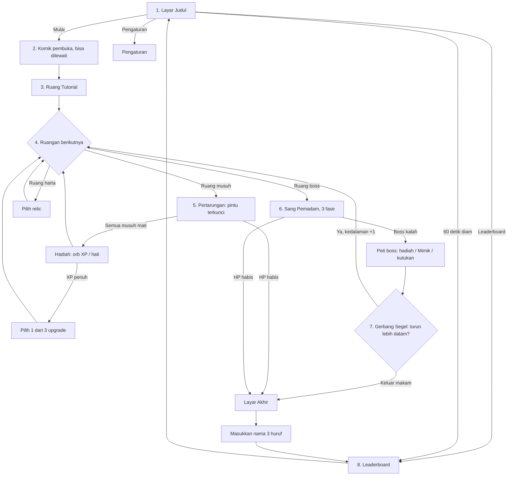

# GAME DESIGN DOCUMENT: RUNECRYPT

> Dokumen ini terus diperbarui. Struktur mengikuti template GDD dari dosen Pengembangan Gim (Game-Design-Document-Template dan materi Pertemuan 10).
> Versi 0.1, 17 November 2026. Riwayat perubahan ada di bagian 14.

| | |
|---|---|
| **Game Name** | Runecrypt (judul sementara, belum dicek apakah sudah dipakai game lain) |
| **Genre** | Roguelite action RPG berbasis ruangan, top-down shooter, dark fantasy |
| **Game Elements** | Menjelajah makam gelap ruang demi ruang, menembakkan sihir api, memakai cahaya untuk melihat musuh, memicu reaksi elemen dengan benda dan musuh di ruangan, mengumpulkan relic yang mengubah cara menyerang, naik level, mengalahkan boss, mengejar peringkat di leaderboard |
| **Player** | 1 pemain. Co-op lokal 2 pemain hanya jika waktu cukup. |

**High concept:** *Makam terkutuk yang menelan cahaya. Satu-satunya penerang adalah sihir api di tanganmu, dan setiap tembakan adalah senjata sekaligus lentera.*

---

## 1. Technical Specs

| | |
|---|---|
| **Technical Form** | 2D pixel art. Tile dan karakter 16x16 piksel, boss 48x48 piksel. |
| **View** | Top-down tiga perempat. Ruangan lebih besar dari satu layar (sekitar 30x17 tile); kamera mengikuti pemain tanpa keluar dari batas ruangan, lalu pindah ke ruangan berikutnya saat pemain lewat pintu (M2.6). |
| **Platform** | PC (Windows), build standalone |
| **Language** | C# |
| **Device** | Laptop. Di expo: 5 laptop dan 1 monitor eksternal. |
| **Engine** | Unity 6000.3.26f1 (Unity 6.3 LTS), Universal Render Pipeline dengan 2D Renderer |
| **Resolusi** | Referensi 320x180 dengan Pixel Perfect Camera, diperbesar bulat 6x menjadi 1920x1080 |
| **Target performa** | Kualitas grafis terbaik. Spesifikasi laptop expo tidak dijadikan batasan (keputusan user, 17 Nov 2026). Target 60 FPS di laptop pengembang (keputusan Claude). |
| **Input** | Unity Input System: keyboard + mouse, dan gamepad |

---

## 2. Game Play

Ruangan pertama hampir gelap total. Yang terlihat hanya lingkaran cahaya jingga di sekitar sang **Pyromancer** dan tulisan kontrol yang terukir samar di lantai batu. Pemain mengarahkan mouse dan menahan klik kiri. Bola api melesat dan menerangi lorong yang dilewatinya. Di ujung jalurnya, dua titik merah ikut menyala: mata seekor **Pelita Sesat** yang langsung menukik ke arah pemain.

Pintu di belakang tertutup jeruji. Pemain menekan Spasi untuk dash melewati serangan, lalu melihat **Genangan Beku** berkilau biru di sudut ruangan. Satu bola api diarahkan ke sana, dan genangan itu meledak menjadi **Uap** putih panas. Uap melukai musuh di dalamnya dan membuat mereka kehilangan jejak pemain. Ruangan sunyi lagi, jeruji terangkat, dan sebutir orb XP melayang ke arah pemain.

Di ruangan-ruangan berikutnya musuh makin beragam. **Tulang Penjaga** berjalan lambat tapi pantang mundur. **Biarawan Beku** menembakkan serpih es dari kejauhan dan meninggalkan genangan es saat mati. **Jubah Guntur** berkedip-kedip penuh muatan listrik. Kalau Jubah Guntur terkena api, ia memicu **Ledakan Cahaya**: seluruh ruangan terang sesaat, dan semua musuh yang bersembunyi terungkap. Di ruang harta, pemain memilih relic seperti **Bara Kembar**, yang membuat setiap bola api terbelah dua. Saat naik level, pemain memilih satu dari tiga peningkatan api.

Setelah 10 sampai 14 ruangan, pemain sampai di depan **Sang Pemadam**: makhluk berjubah raksasa yang memakan cahaya. Ia memadamkan sebagian cahaya ruangan, dan serangannya ditandai lingkaran terang di lantai. Mengalahkannya membuka tangga ke **lapisan yang lebih dalam**: ruangan lebih gelap dan musuh lebih banyak, sampai pemain akhirnya tumbang. Nama pemain lalu dicatat di leaderboard booth.

### 2.1 Game Play Outline

| Bagian | Isi |
|---|---|
| **Opening the game application** | Layar judul dengan logo Runecrypt yang menyala di atas makam gelap. Pilihan: *Mulai*, *Leaderboard*, *Pengaturan*, *Keluar*. Kalau 60 detik tidak ada input, game masuk mode tontonan (attract mode) yang menampilkan leaderboard, lalu kembali ke layar judul. |
| **Game options** | Volume musik, volume SFX, kecerahan (gamma) untuk ruang expo yang terang, dan tampilan kontrol keyboard atau gamepad. |
| **Story synopsis** | Lihat bagian 2.2. |
| **Modes** | *Run* (mode utama). Setelah boss kalah, pemain bisa memilih *Turun Lebih Dalam* (lanjut tanpa batas) atau *Keluar Makam* (selesai dengan skor). |
| **Game elements** | Bergerak, menembak, dash, skill elemen, cahaya, reaksi elemen, relic, level-up, ruangan acak, boss. Rinciannya di bagian 4–6. |
| **Game levels** | Satu lantai berisi 10–14 ruangan yang disusun acak dari prefab buatan tangan. Lapisan lebih dalam memakai prefab yang sama dengan tingkat kesulitan naik. Lihat bagian 9. |
| **Player's controls** | Lihat bagian 8.1. |
| **Winning** | Mengalahkan Sang Pemadam berarti run dianggap menang. Pemain lalu boleh lanjut untuk mengejar skor. |
| **Losing** | HP habis. |
| **End** | Layar akhir menampilkan kedalaman, waktu, jumlah musuh, dan relic yang dikumpulkan. Pemain memasukkan nama 3 huruf, lalu leaderboard tampil dan kembali ke layar judul. |
| **Why is all this fun?** | (1) Cahaya adalah senjata. Setiap tembakan juga mengungkap musuh dan membuatnya lebih rentan, jadi menyerang dan melihat menyatu. (2) Reaksi elemen memberi momen "wah" yang bisa dipicu pemain secara sengaja dari benda di ruangan. (3) Relic bertumpuk membuat setiap run terasa berbeda. (4) Run pendek dengan leaderboard memancing pengunjung untuk mencoba lagi. |

### 2.2 Story Synopsis
Dahulu kala, Runecrypt adalah makam tempat para penjaga api disemayamkan. Sesuatu terbangun di dasarnya, yaitu **Sang Pemadam**, makhluk yang memakan setiap cahaya yang mendekat. Obor padam satu per satu, dan para penjaga bangkit sebagai pelayan kegelapan. Pyromancer terakhir turun ke makam membawa bara terakhir di tangannya. Cerita disampaikan lewat **komik pembuka 5 panel (±20 detik, bisa dilewati dengan satu tombol)** dan tulisan di dinding. Pyromancer adalah murid penjaga api terakhir. Gurunya turun ke makam dan tidak kembali. Yang tersisa hanya lenteranya, berisi bara kecil yang condong ke arah makam.

**Cerita per lantai.**
- **Lantai 1:** musuh Tulang adalah para penjaga yang jatuh. Pemain mengalahkan wujud pertama Sang Pemadam. Tungku makam lalu menyala lagi, dan Sang Pemadam mundur ke bawah lewat Gerbang Segel.
- **Lantai berikutnya:** Sang Pemadam makin kuat karena menelan lebih banyak cahaya. Tulisan di dinding memberi petunjuk tentang nasib sang guru.
- **Lantai 3** *(jika waktu cukup)*: sang guru muncul sebagai boss tengkorak.

Naskah lengkap ada di `Docs/specs/2026-11-18-peti-pintu-cerita-design.md` §8–9.

### 2.3 Key Features
- **Cahaya adalah senjata.** Ruangan gelap gulita. Tubuh pemain dan setiap bola api adalah sumber cahaya. Musuh di gelap hanya terlihat dari mata merahnya dan bergerak lebih cepat, sedangkan musuh yang tersingkap cahaya menerima damage lebih besar (bagian 5.5).
- **Reaksi elemen dari lingkungan.** Api yang mengenai es memicu Uap, api yang mengenai petir memicu Ledakan Cahaya. Ruangan berisi genangan, tiang, dan musuh berelemen yang bisa dipakai pemain.
- **Relic yang mengubah cara menyerang.** Split, pierce, bounce, homing, dan lainnya. Efeknya bertumpuk dan terlihat langsung pada proyektil.
- **Satu lantai sampai boss 3 fase sekitar 20 menit**, lalu lanjut tanpa batas untuk pemain yang jago (bagian 9.4).
- **Leaderboard expo** dengan nama 3 huruf ala arcade.
- **Semua aset buatan sendiri.** Pixel art dan suara dibuat lewat script, jadi gayanya konsisten.

---

## 3. Design Document

### 3.1 Design Guidelines
1. **Gelap tapi terbaca.** Ruang expo terang dan layar laptop sering silau. Pemain dan musuh diberi rim light (garis tepi terang), mata musuh selalu menyala, dan telegraph serangan memakai warna terang. Kecerahan diuji langsung di laptop yang dibawa ke expo.
2. **Bisa dipahami dalam 30 detik tanpa penjelasan.** Kontrol terukir di lantai ruangan pertama. Reaksi pertama dipicu di ruangan tutorial.
3. **Orisinal.** Struktur ruangan acak dan relic bertumpuk mengikuti genre roguelite berbasis ruangan yang dipopulerkan The Binding of Isaac. Tema, karakter, art, item, musik, dan layout ruangan dibuat sendiri dan tidak meniru game tersebut.
4. **Konsisten secara visual.** Semua sprite memakai satu palet dan ukuran 16x16 (boss 48x48). Utamakan makhluk melayang atau berjubah supaya animasinya realistis untuk dibuat. Juice dikerjakan di engine: flash putih saat kena damage, squash and stretch, dissolve saat mati, hit-stop, dan screen shake.
5. **Mudah ditambah.** Relic, musuh, reaksi, upgrade, ruangan, dan class berupa data (ScriptableObject) dan prefab. Menambah konten baru tidak mengharuskan mengubah kode pemain. Lihat bagian 12.
6. **Kualitas grafis terbaik.** Bayangan dinamis, banyak sumber cahaya, dan efek partikel dipakai penuh, tanpa mode kualitas rendah (keputusan user, 17 Nov 2026).

### 3.2 Game Design Definitions
- **Fokus utama:** bertahan dan membersihkan ruangan di dalam gelap dengan memanfaatkan cahaya dan reaksi elemen.
- **Ruangan bersih:** semua musuh di ruangan mati. Jeruji pintu terbuka dan hadiah ruangan muncul.
- **Transisi antar ruangan:** pemain berjalan melewati pintu yang terbuka. Kamera pindah ke ruangan baru (di dalam ruangan kamera mengikuti pemain) dan pintu ruangan baru (kalau ada musuh) tertutup setelah pemain masuk.
- **Transisi lantai:** setelah boss kalah, muncul tangga ke bawah. Melewatinya membuat lantai baru di kedalaman +1.
- **Seed:** kode 8 karakter (misalnya `K7Q2-9XMA`) yang menentukan isi satu run: susunan lantai, urutan titik spawn, tawaran relic, isi peti, dan jatuhan. Setiap run mendapat seed acak baru. Run dengan seed yang sama berisi hal yang sama, tetapi jalannya pertarungan tetap ditentukan pemain. Rinciannya di bagian 9.1.
- **Menang:** Sang Pemadam kalah di kedalaman 1.
- **Kalah:** HP pemain mencapai 0.
- **Skor:** `kedalaman × 1000 + musuh dikalahkan × 10 + bonus waktu`. Bonus waktu = maks(0, 600 − detik sampai boss pertama kalah) × 2 *(batas 600 detik dibuat saat run 6–8 menit; perlu disetel ulang untuk run 20 menit di M5)*. Memilih *Keluar Makam* setelah boss kalah memberi bonus **+1500**, lebih besar dari nilai satu kedalaman. Jadi lanjut ke bawah benar-benar soal risiko: bisa dapat skor lebih tinggi, tapi bonus keluar hilang kalau mati. *Angka ini awal dan disetel saat playtest. (keputusan Claude)*

### 3.3 Game Flowchart

| No. | Elemen flowchart | Dibahas di |
|---|---|---|
| 1 | Layar Judul | 8.2 |
| 2 | Layar Cerita | 2.2 |
| 3 | Ruang Tutorial | 9.2 |
| 4 | Generator ruangan | 9.1 |
| 5 | Pertarungan | 4, 5, 6 |
| 6 | Boss | 6.3 |
| 7 | Lapisan lebih dalam | 9.3 |
| 8 | Leaderboard | 8.2 |

---

## 4. Player Definition

**Pyromancer** adalah penyihir api berjubah, penjaga bara terakhir. Ia satu-satunya class di MVP. Frost Warden (es) dan Stormcaller (petir) masuk daftar "jika waktu cukup". Ketiga nama class dipertahankan (keputusan user, 25 Nov 2026): "Pyromancer" adalah istilah fantasi umum, dan Stormcaller berbeda dari Stormwarden/Stormblade di Soul Knight Prequel.

### 4.1 Player Definitions

| Definisi | Nilai awal | Keterangan |
|---|---|---|
| **Health** | 6 HP, tampil sebagai 3 hati (1 hati = 2 HP) | Kena serangan biasa −1 HP. Serangan boss −2 HP. |
| **Weapon: Bola Api** | Damage 3, 3 tembakan/detik, jangkauan 7 tile | Menembak ke arah bidikan. Memberi status **Terbakar** (1 damage/detik selama 2 detik). Bola api memancarkan cahaya radius 1,75 tile (M2.6) dan meninggalkan ekor bara. |
| **Skill: Kobaran** | Cooldown 6 detik | Cincin api di sekitar pemain dengan radius 2,5 tile dan damage 6. Cahayanya menerangi radius 4,5 tile selama 1 detik (M2.6), lebih luas dari radius damage supaya musuh di tepi ikut Tersingkap. Kobaran dihitung sebagai api, jadi bisa memicu reaksi. |
| **Action: Dash** | Jarak 3 tile, cooldown 0,8 detik | Kebal serangan (i-frame) selama 0,2 detik. |
| **Cahaya pemain** | Radius 3 tile, jingga hangat | Sumber cahaya utama. Musuh di dalamnya Tersingkap (bagian 5.5). Radius bisa naik lewat relic atau upgrade, dan turun di lapisan dalam atau fase 3 boss. |
| **Kecepatan gerak** | 5 tile/detik | |

*Semua angka adalah titik awal dan akan disetel saat playtest.*

### 4.2 Player Properties

| Properti | Bisa berubah karena | Feedback ke pemain |
|---|---|---|
| HP | Serangan musuh, Jantung Tungku, upgrade *Nyala Hidup* | Sprite flash putih, layar sedikit berguncang, hati di HUD pecah. Saat HP tinggal 1 hati: detak jantung terdengar dan tepi layar memerah. |
| Damage dan laju tembak | Relic, upgrade | Proyektil membesar atau warnanya makin terang, suara tembakan makin berat |
| Radius cahaya | Relic, upgrade, kedalaman, boss | Lingkaran cahaya melebar atau menyempit secara halus |
| XP dan level | Orb XP dari musuh | Bar XP terisi. Saat naik level: kilatan, suara lonceng, dan panel 3 pilihan. |
| Cooldown Kobaran dan dash | Relic, upgrade | Ikon di HUD terisi, lalu berkedip saat siap |

### 4.3 Player Rewards (power-ups dan pick-ups)
- **Orb XP:** dijatuhkan musuh dan bergerak sendiri ke pemain.
- **Hati:** kadang jatuh dari musuh, memulihkan 2 HP.
- **Relic:** sebelum boss hanya didapat di ruang harta (pilih 1 dari 2). Setiap lantai pasti punya 1 ruang harta, dan ruang harta kedua hanya muncul dengan peluang 10% (keputusan user 18 Nov 2026; angka 10% usulan Claude, disetel saat playtest). Jadi dapat 2 relic sebelum boss itu jarang, tapi bisa. Ruang musuh tidak menjatuhkan relic. Daftarnya di bagian 5.2.
- **Upgrade level-up:** pilih 1 dari 3. Daftarnya di bagian 5.3.
- **Peti boss:** muncul setelah boss kalah. Isinya diundi: hadiah relic (70%), Mimik (15%), atau kutukan kecil (15%). Detail di bagian 6.4.

---

## 5. Mekanik Inti

### 5.1 Elemen dan Reaksi
Pemain hanya memakai **api**. Elemen kedua datang dari **ruangan dan musuh**. Setiap target (musuh atau benda) bisa punya elemen bawaan. Kalau target berelemen es atau petir terkena serangan api, reaksi terjadi di posisi target.

| Reaksi | Pemicu | Efek | MVP? |
|---|---|---|---|
| **Uap** | Api + Es (Genangan Beku, Kristal Es, Biarawan Beku) | Awan uap radius 2,5 tile selama 3 detik, 2 damage per 0,5 detik. Musuh di dalam uap **buta**: kehilangan jejak pemain dan berjalan acak. | Ya |
| **Ledakan Cahaya** | Api + Petir (Tiang Petir, Jubah Guntur) | Ledakan radius 3 tile dengan damage 10 dan stun 0,5 detik. **Seluruh ruangan terang selama 1,5 detik** dan semua musuh terlihat. | Ya |
| **Shatter** | Es + Petir | Damage besar ke target beku | Tidak, menunggu class kedua |

Aturan reaksi *(keputusan Claude, dicek user)*:
- **Reaksi tidak melukai pemain.** Pengunjung expo boleh bereksperimen tanpa takut.
- **Musuh berelemen punya muatan.** Setelah memicu reaksi, muatannya kosong selama 4 detik (sprite memudar) dan serangan api biasa berlaku seperti biasa. Dengan begitu Biarawan Beku tidak memicu Uap pada setiap tembakan.

Benda reaksi di lingkungan:
- **Genangan Beku:** tile lantai yang memicu Uap lalu hilang. Muncul kembali setelah 8 detik.
- **Kristal Es:** benda yang bisa dihancurkan. Memicu Uap sekali, lalu pecah. Pecahannya memberi 4 damage ke musuh dalam 1,5 tile dan **tidak melukai pemain** (M3a, *keputusan Claude*: konsisten dengan "reaksi tidak melukai pemain"). Arena prototipe punya dua Kristal Es.
- **Tiang Petir:** benda permanen. Memicu Ledakan Cahaya, lalu perlu 5 detik untuk mengisi muatan lagi. Saat penuh, ujungnya berkilat sehingga juga menjadi sumber cahaya kecil.
- **Kristal Es dan Tiang Petir juga melukai musuh di dekatnya** (M3, pelajaran dari Soul Knight, keputusan user 25 Nov 2026). Pemain punya alasan memancing musuh ke dekat benda itu. Pemain sendiri tidak terluka, sesuai aturan "reaksi tidak melukai pemain" (disetujui user bersama rencana M3a, 25 Nov 2026).

### 5.2 Relic (15 untuk MVP)

| # | Nama | Efek |
|---|---|---|
| 1 | **Bara Kembar** | Setiap tembakan mengeluarkan 2 bola api yang menyebar 10° (split) |
| 2 | **Taring Obsidian** | Bola api menembus 1 musuh tambahan (pierce) |
| 3 | **Cermin Retak** | Bola api memantul dari dinding 2 kali (bounce) |
| 4 | **Mata Ngengat** | Bola api berbelok perlahan ke musuh terang terdekat (homing) |
| 5 | **Sumbu Panjang** | Jangkauan +30%, cahaya bola api lebih lebar |
| 6 | **Lilin Ganda** | Laju tembak +20% |
| 7 | **Abu Pekat** | Durasi Terbakar +2 detik |
| 8 | **Arang Berat** | Bola api +40% lebih besar dan damage +20%, tapi 15% lebih lambat |
| 9 | **Lentera Tulang** | Radius cahaya pemain +25% |
| 10 | **Jantung Tungku** | Max HP +2 (satu hati) dan pulih penuh |
| 11 | **Mahkota Asap** | Radius dan durasi Uap +50% |
| 12 | **Gema Guntur** | Ledakan Cahaya: radius +1 tile, terang +1 detik |
| 13 | **Sayap Jelaga** | Cooldown dash −30%, dash meninggalkan jejak api |
| 14 | **Rantai Nyala** | Musuh yang mati karena api menularkan Terbakar ke musuh terang terdekat |
| 15 | **Tengkorak Pijar** | Satu tengkorak api mengorbit pemain, melukai musuh yang disentuhnya, dan memberi cahaya kecil |

Relic bertumpuk: dua relic split menambah jumlah proyektil. Ikon relic tampil di HUD. *Jika waktu cukup:* relic terkutuk dari Shrine (contohnya **Lidah Kegelapan**: damage +50% tapi radius cahaya −40%), dan total 30 relic.

### 5.3 Upgrade Level-up (pilih 1 dari 3)
XP yang dibutuhkan naik setiap level. Pool awal:

| Upgrade | Efek |
|---|---|
| **Api Membara** | Damage bola api +1 |
| **Bara Tak Padam** | Terbakar memberi +1 damage/detik |
| **Napas Tungku** | Cooldown Kobaran −1 detik |
| **Cahaya Melebar** | Radius cahaya +0,5 tile |
| **Uap Mendidih** | Damage Uap +50% |
| **Kilat Mentari** | Damage Ledakan Cahaya +50% |
| **Langkah Ringan** | Kecepatan gerak +10% |
| **Nyala Hidup** | Pulihkan 2 HP |

### 5.4 Status
- **Terbakar:** damage over time. Musuh yang terbakar memancarkan cahaya redup, jadi ikut terlihat.
- **Buta** (dari Uap): musuh berjalan acak dan tidak menyerang.
- **Stun** (dari Ledakan Cahaya): musuh diam sesaat.

### 5.5 Aturan Cahaya
Cahaya tidak hanya menentukan apa yang terlihat, tapi juga mengubah aturan pertarungan (keputusan user, 17 Nov 2026). Tiga aturan di bawah ini, beserta angkanya, adalah *keputusan Claude*.

**Kapan sebuah titik dihitung terang.** Titik itu harus berada di dalam radius salah satu sumber cahaya dan tidak terhalang dinding. Sumber cahaya meliputi pemain, bola api, Kobaran, Uap, Ledakan Cahaya, Tiang Petir yang bermuatan, musuh yang Terbakar, dan Tengkorak Pijar. Radius aturan diambil dari angka yang sama dengan radius Light2D-nya, jadi area yang tampak terang selalu sama dengan area yang dihitung terang. Tidak ada keadaan "terlihat terang tapi dihitung gelap".

| Aturan | Efek | Feedback |
|---|---|---|
| **1. Tersingkap** | Musuh di area terang menerima damage +25%. Berlaku juga untuk boss. | Tubuh musuh tampil utuh, dan angka damage berwarna kuning terang. Tanpa garis tepi (dihapus 18 Nov 2026, keputusan user: tubuh yang terang sudah cukup membedakan). Musuh di gelap hanya terlihat dari matanya. |
| **2. Bidikan butuh cahaya** | Efek yang mencari sasaran sendiri hanya bisa memilih musuh yang terang. Ini berlaku untuk homing (bola api yang otomatis berbelok mengejar musuh, dari relic Mata Ngengat) dan untuk tularan Rantai Nyala. | Musuh yang sedang dikejar homing diberi penanda kecil berbentuk bara. |
| **3. Gelap menguatkan musuh** | Musuh di area gelap bergerak 20% lebih cepat. | Jejak asap tipis keluar di belakang musuh yang sedang berada di gelap. |

Akibatnya terhadap desain:
- **Ledakan Cahaya** dan kilatan Kobaran menerangi seluruh ruangan atau area di sekitar pemain sesaat, sehingga semua musuh di dalamnya Tersingkap. Momen itu adalah jendela untuk memberi damage besar.
- Relic dan upgrade yang menambah radius cahaya, seperti Lentera Tulang, Sumbu Panjang, dan Cahaya Melebar, kini juga menambah daya serang. Karena itu relic terkutuk Lidah Kegelapan benar-benar menjadi pertukaran yang sulit.
- Cahaya yang menyempit di lapisan lebih dalam dan di fase 2–3 boss membuat pertarungan lebih sulit, bukan hanya lebih gelap.
- **Cahaya dari musuh yang Terbakar ikut membuatnya Tersingkap** (keputusan user, 17 Nov 2026). Jadi setelah kena bola api pertama, musuh itu Tersingkap selama Terbakar aktif. Tembakan berikutnya mendapat +25%, dan damage Terbakar sendiri menjadi 1,25/detik. Api memang dirancang "menandai" sasarannya. Kalau di uji seru (bagian 13) damage api terasa terlalu kuat, angka yang disetel adalah damage dasar atau bonus Tersingkap, bukan aturan ini.
- **Anglo** (M2.5, spec `Docs/specs/2026-11-24-isi-makam-design.md`) adalah sumber cahaya lingkungan. Anglo menyala kalau terkena Bola Api atau Kobaran, lalu menerangi radius 2,5 tile sampai ruangan dimulai ulang. Musuh di dekatnya jadi Tersingkap dan kehilangan bonus kecepatan gelap. Reaksi tidak menyalakan Anglo. Nisan, pilar, dan sarkofagus memotong cahaya seperti dinding.
- **Pengecualian: kilatan efek** (M2.6). Kilatan moncong, kilatan di titik kena, dan kilatan besar Kobaran memakai Light2D tanpa bayangan dan **tidak** dihitung sebagai sumber cahaya aturan, sama seperti kilatan efek mati di M1.5. Durasinya paling lama 0,2 detik. Kalau ikut aturan, setiap tembakan akan menyingkap musuh di titik kena dan ketegangan gelap hilang *(keputusan Claude)*.

---

## 6. Musuh dan Boss

Semua musuh punya **mata merah yang selalu menyala** (sprite mata memakai material unlit, jadi terlihat di gelap) dan rim light tipis.

### 6.1 Musuh MVP

| Nama | Wujud | Elemen | Perilaku | HP awal | Gaya mati |
|---|---|---|---|---|---|
| **Pelita Sesat** | Roh api mati berwarna biru kehitaman, rongga mata kosong, jejak asap. Dibuat seram, bukan imut. | — | Melayang diam 1,4 dtk, ancang-ancang 0,35 dtk dengan mata membesar (telegraph, arah dikunci), menukik 0,45 dtk dengan kecepatan ×3, lalu mundur 0,6 dtk. Kecepatan dasar 2,4, damage sentuh 1 tiap 0,8 dtk, biaya budget 1 *(angka keputusan Claude, M3a)*. Mengajarkan pemain untuk dash. | 6 | Nyala padam menjadi asap hitam, mata memudar paling akhir |
| **Tulang Penjaga** | Kerangka penjaga makam berperisai karatan | — | Berjalan lambat dan terus mengejar. Serangan jarak dekat. Sering muncul berkelompok. | 12 | Abu dan serpihan tulang, tumpukan abu berpendar tertinggal (sudah dibuat di M1.5) |
| **Biarawan Beku** | Sosok berjubah biru pucat yang melayang | Es | Menjaga jarak 4–6 tile dan menembakkan 3 serpih es (sebaran 15°, damage 1, kecepatan 6, jangkauan 9) setiap 2,2 dtk kalau pemain dalam 9 tile; tidak menembak saat buta atau stun. Serpih berhenti di dinding dan benda padat. Kecepatan 1,6, biaya budget 2 *(angka keputusan Claude, M3a)*. Saat mati meninggalkan Genangan Beku. Terkena api langsung memicu Uap (muatan elemen, jeda 4 dtk). | 10 | Pecah menjadi serpih es, meninggalkan Genangan Beku |
| **Jubah Guntur** | Jubah kosong yang berkedip, diselimuti listrik | Petir | Berteleportasi pendek, lalu melepas kilatan garis lurus yang di-telegraph 0,6 detik. Terkena api memicu Ledakan Cahaya. | 16 | Jubah jatuh lemas sambil memercikkan listrik terakhir |
| **Mimik** | Peti kayu makam dengan gigi, lidah, dan mata merah. Sebelum dibuka, sesekali "bernapas" atau berkilat merah di celah tutupnya. | — | Hanya muncul dari peti boss. Melompat ke arah pemain 3 kali, lalu diam 1,2 detik. Saat mati menjatuhkan hadiah peti. | ±36 (disetel saat playtest) | Berdarah |

Gaya mati ditentukan per jenis musuh (keputusan user, 17 Nov 2026): kerangka menjadi abu dan tulang, musuh berdaging berdarah. Mimik adalah satu-satunya musuh MVP yang berdaging, jadi gaya berdarah tampil lewat Mimik. Gaya ini cukup berupa prefab baru di `EnemyDefinition` (`deathEffect`, `remains`) tanpa mengubah kode.

### 6.2 Kemunculan
Musuh muncul di titik spawn yang sudah ditandai di prefab ruangan, dengan efek asap gelap 0,5 detik supaya tidak muncul tiba-tiba di atas pemain. Jumlah dan jenisnya diatur oleh "budget" kesulitan ruangan yang naik seiring urutan ruangan dan kedalaman. Di dalam satu lantai, ruangan berikutnya hanya menambah **jumlah** musuh, tidak menaikkan HP dan damage (keputusan user, 18 Nov 2026). Isi tiap gelombang dipilih acak dari **budget** sebesar ukuran gelombang, memakai biaya tiap jenis musuh (Tulang Penjaga 1, Pelita Sesat 1, Biarawan Beku 2; M3a). Musuh datang dalam **3 gelombang per ruangan**. Gelombang berikutnya mulai saat sisa musuh tinggal 4 atau kurang dan paling sedikit separuh gelombang sebelumnya sudah terbunuh (jadi gelombang kecil di ruangan awal tidak langsung disusul), dan ruangan selesai setelah gelombang terakhir habis. Satu gelombang paling banyak 8 musuh, dan **paling banyak 12 musuh hidup bersamaan** supaya layar tetap terbaca di gelap (M2.6, menggantikan batas 8 per ruangan).

### 6.3 Boss: Sang Pemadam
Makhluk berjubah raksasa berukuran 48x48 piksel. Wajahnya hanya lubang gelap dengan mata merah, dan "tangan"-nya berupa asap. Semua serangannya didahului **telegraph terang** di lantai.

| Fase (sisa HP) | Perilaku |
|---|---|
| **1. Penjaga** (100–66%) | Menembakkan pola proyektil kegelapan melingkar. Memanggil 2 Pelita Sesat setiap 10 detik. |
| **2. Pemadam** (66–33%) | Memadamkan cahaya ruangan: radius cahaya pemain −30%. Memunculkan Kristal Es dan Tiang Petir di arena, jadi pemain didorong memakai reaksi. Menghantam lantai dengan AoE lingkaran besar. |
| **3. Kelaparan** (33–0%) | Kegelapan menutup dari tepi layar. Serangan makin cepat dan AoE beruntun. Damage yang diterimanya −50%, kecuali saat stun. Terkena Ledakan Cahaya membuatnya stun 1,5 detik dan damage yang diterimanya ×1,5 selama stun. Tiang Petir dari fase 2 tetap ada. Boss tetap bisa dikalahkan tanpa reaksi, hanya jauh lebih lama. *(keputusan Claude)* |

Total HP boss dan durasi tiap fase disetel saat playtest. Target pertarungan boss sekitar 90–120 detik.

### 6.4 Pintu dan Peti Boss
Keputusan user, 18 Nov 2026. Detail lengkap ada di `Docs/specs/2026-11-18-peti-pintu-cerita-design.md`.

| Pintu | Tampilan | Fungsi |
|---|---|---|
| **Pintu ruangan** | Kayu dan besi gelap, tanpa cahaya | Terkunci sampai musuh habis |
| **Pintu ruang harta** (opsional) | Bingkai bersisik emas | Sama dengan pintu ruangan |
| **Pintu boss** | Mengikuti boss di dalamnya, sebagai petunjuk. Untuk Sang Pemadam: tirai jubah gelap, asap hitam merembes, dan dua mata merah. Obor di sampingnya padam saat pemain mendekat. | Disimpan di data boss, jadi boss baru membawa pintunya sendiri |
| **Gerbang Segel** | Batu besar dengan rune api yang menyala terang | Muncul setelah boss kalah. Pemain memilih **Turun lebih dalam** atau **Keluar makam**. |

**Peti boss** muncul bersama Gerbang Segel. Pemain boleh mengabaikannya. Isinya diundi saat peti muncul:
- **Hadiah (bobot 70):** 1 relic yang belum dimiliki pemain, dengan bobot Biasa : Langka = 3 : 1. Kalau semua relic sudah dimiliki, diganti pemulihan HP penuh.
- **Mimik (bobot 15):** peti hidup menyerang. Kalau dikalahkan, Mimik menjatuhkan hadiahnya.
- **Kutukan (bobot 15):** di MVP hanya *Kutukan Redup*, yaitu radius cahaya −20% sampai lantai berikutnya selesai. Dihitung setelah batas minimal 60%.
- **Pengaman:** peti boss pertama dalam satu run selalu berisi Hadiah, dan zonk tidak pernah muncul dua kali berturut-turut.

**Cutscene peti** (Unity Timeline, total paling lama 2,5 detik, bisa dilewati):
- Pembukanya sama untuk semua hasil: peti bergetar dan cahaya merembes dari celah tutupnya.
- Akhirnya berbeda untuk Hadiah, Mimik, dan Kutukan.
- Selama cutscene, pemain kebal.

---

## 7. Visual dan Audio

### 7.1 Visual
- **Pixel art 16x16**, boss 48x48. Semua dibuat lewat script Python + Pillow di `ArtSource/scripts/`. Hasil awal ada di `ArtSource/prototype/`.
- **Palet:** ungu-hitam gelap untuk makam (`#1A1420`, `#342852`, `#544280`), jingga-kuning untuk api (`#FF8A3D`, `#FFCC66`, `#FFE296`), tulang (`#D9D1BD`), dan merah mata (`#E0474C`). Biru pucat untuk es dan putih-ungu untuk petir ditambahkan dengan gaya yang sama.
- **Cahaya:** Light2D URP. Global light sangat redup. Point light dipasang pada pemain, proyektil, reaksi, Tiang Petir, dan musuh yang terbakar. ShadowCaster2D pada dinding dan pilar.
- **Animasi:** 4 frame untuk diam, gerak, serang, dan mati. Juice di engine (M1.5, angka lengkap di `Docs/specs/2026-11-17-juice-design.md` §5):
  - Kena: kedipan putih 0,08 dtk (penuh saat Tersingkap, redup alpha 0,35 di gelap), hit-stop 0,03 dtk, knockback 4 tile/dtk, percikan bara.
  - Angka damage dari sprite digit buatan sendiri, dibulatkan: kuning besar saat Tersingkap, abu-abu kecil di gelap, jingga untuk Terbakar, putih untuk Uap.
  - Mati: hit-stop 0,06 dtk, guncangan ringan, efek mati dan sisa per jenis musuh (bagian 6.1).
  - Pemain kena: kedipan merah, hit-stop 0,08 dtk, guncangan sedang, lalu berkedip selama kebal 0,8 dtk.
  - Tembakan hanya menyentak kamera 1 piksel (tanpa guncangan) supaya tidak memicu mabuk gerak.
  - Squash and stretch dan dissolve belum dibuat.
- **Kit makam (M2.5):** variasi lantai (biasa ±70%, retak, berlumut, ada tulang, rune pudar), overlay dinding atas (relung berisi tengkorak, obor padam, bata retak), dekorasi lepas (sarang laba-laba, rantai, tulang, panji, lilin padam), debu yang hanya tampak di area terang, dan suara ambien makam. Benda yang bisa dipakai: Anglo (saat padam, bara kecil unlit berkedip di atasnya sebagai petunjuk, tanpa cahaya aturan; satu Anglo sudah berada di dalam cahaya awal pemain), Guci Abu (pecah, peluang 15% menjatuhkan Bara Pemulih +1 HP), serta nisan, sarkofagus, dan pilar sebagai tempat berlindung.
- **Efek heboh yang tetap terbaca (M2.6):** tembakan memberi kilatan moncong dan ekor bara; bola api yang kena memberi semburan bara dan kilatan; Kobaran memberi cincin api tebal, kilatan besar, guncangan sedang, dan percikan ke segala arah. Aturannya: efek visual pemain hilang dalam ±0,4 detik; efek padat tidak lebih besar dari radius serangannya; kilatan cahaya ≤ 0,2 detik tanpa bayangan (bagian 5.5); **mata musuh dan telegraph selalu digambar di atas semua efek pemain** (sorting order 10, efek pemain ≤ 5); jumlah partikel dibatasi.
- **Penghalang setengah tinggi (M4):** nisan rendah menahan gerak tetapi bisa ditembus tembakan; pilar dan sarkofagus menahan semuanya.
- **Keterbacaan:** benda yang bisa dipakai punya garis terang 1 piksel di sisi atas dan bentuk lebih gemuk; dekorasi lebih gelap dan rata tanpa garis terang. Tidak ada merah terang selain mata musuh.

### 7.2 Audio
SFX sintesis lewat script Python sudah dicoba dan dinilai kurang (17 Nov 2026), jadi **SFX memakai paket gratis berlisensi CC0**. Script `ArtSource/scripts/make_sfx_cc0.py` hanya memotong, mencampur, dan menormalkan file CC0 mentah. Sumber dan lisensinya dicatat di bagian kredit (§14). Musik belum ditentukan.
- **SFX:** tembakan api, kena musuh, Kobaran, dash, Uap (desis), Ledakan Cahaya (dentum dan dengung), musuh mati, pintu jeruji turun/naik, pengambilan relic, level-up, detak jantung saat HP rendah, langkah dari arah gelap.
- **Musik:** dengung ambient gelap berlapis untuk eksplorasi, lapisan perkusi saat pintu terkunci, tema boss yang intens, dan musik singkat di layar akhir.
- Booth expo memakai headphone.

---

## 8. User Interface (UI)

### 8.1 Kontrol

| Aksi | Keyboard + mouse | Gamepad (stasiun monitor) | Cadangan keyboard |
|---|---|---|---|
| Bergerak | WASD | Stik kiri | WASD |
| Bidik dan tembak | Arahkan mouse, tahan klik kiri | Stik kanan (menembak otomatis ke arah stik) | Tombol panah (8 arah) |
| Kobaran | Klik kanan | RT | Shift kiri |
| Dash | Spasi | A | Spasi |
| Jeda | Esc | Start | Esc |
| Pilih upgrade/relic | Klik atau tombol 1–3 | D-pad + A | 1–3 |

Uji tata letak terburuk: pemain yang hanya memakai keyboard laptop tanpa mouse tetap bisa bermain penuh dengan cadangan panah.

### 8.2 Layar
- **Layar Judul:** Mulai, Leaderboard, Pengaturan, Keluar. Attract mode setelah 60 detik tanpa input.
- **HUD:** hati (kiri atas), bar XP dan level (bawah), ikon cooldown Kobaran dan dash (kiri bawah), deretan ikon relic (atas), minimap ruangan yang sudah dikunjungi (kanan atas), kedalaman dan timer (kanan atas di bawah minimap).
- **Panel Level-up:** 3 kartu upgrade. Game berhenti sejenak selama memilih.
- **Jeda:** Lanjut, Pengaturan, Keluar ke Judul. Seed run ditampilkan kecil di pojok.
- **Layar Akhir:** statistik run termasuk seed, input nama 3 huruf (bisa dipakai dengan gamepad), lalu leaderboard 10 besar.
- **Leaderboard:** disimpan lokal per laptop di file JSON (`Application.persistentDataPath`). Tidak memakai jaringan.

---

## 9. Level Specs

### 9.1 Generator Lantai
- **Seed run** (keputusan user, 26 Nov 2026): semua keacakan isi run berasal dari satu seed 32 bit, supaya tiap run berbeda tetapi bisa diulang persis.
  - Setiap sistem memakai **stream acak sendiri** yang diturunkan dari seed: `floor` (susunan lantai), `spawn` (urutan titik spawn), `wave` (susunan jenis musuh per gelombang, M3a), `relic` (tawaran relic), `loot` (jatuhan guci), `chest` (isi peti boss), dan sistem baru dengan nama sendiri. Dengan begitu, undian ke-n setiap sistem selalu sama untuk seed yang sama, dan undian tambahan di satu sistem tidak menggeser sistem lain.
  - Kodenya 8 karakter Crockford base32 (tanpa I, L, O, U) dengan 1 karakter checksum, jadi seed yang diketik dengan satu huruf salah ditolak.
  - Saat ini seed tampil di HUD, dan untuk debug bisa dipaksa lewat field `debugSeed` di ArenaDirector. Input seed oleh pemain di layar judul direncanakan menyusul (M5 atau sesudahnya).
  - Yang **tidak** mengikuti seed: efek kosmetik (guncangan, serpihan, pitch suara) dan gerak musuh per frame, karena gerak bergantung pada fisika dan input pemain.
- Lantai disusun di grid. Random walk dari ruang awal menghasilkan **10–14 ruangan**.
- **Ruang boss** ditempatkan di ujung buntu terjauh dari ruang awal. **Ruang harta** pasti ada 1 di ujung buntu lain. Ruang harta kedua muncul dengan peluang 10%, kalau masih ada ujung buntu tersisa (bagian 4.3).
- Setiap ruangan adalah **prefab Tilemap buatan tangan** berukuran **lebih besar dari satu layar** (sekitar 30x17 tile, kamera mengikuti pemain; M2.6). Prefab menandai titik pintu (atas, bawah, kiri, kanan), titik spawn musuh, dan posisi benda reaksi. Pintu yang tidak terhubung ditutup tembok.
- Target MVP: **10 prefab ruang musuh**, 1 ruang awal/tutorial, 2 ruang harta, dan 1 arena boss.
- Prefab ruangan memakai kit makam M2.5 (prefab Anglo, Guci Abu, nisan, sarkofagus, dan sprite dekorasi). Benda yang menahan gerak ditaruh di pinggir dan sudut, menjauhi titik spawn dan pintu. Saat pemain masuk ruangan, sinyal `RoomEvents.Started` mengembalikan Anglo dan guci ke keadaan awal.

### 9.2 Ruang Tutorial
Kontrol terukir di lantai, dengan ikon yang menyesuaikan perangkat input yang terakhir dipakai. Isinya: 2 Pelita Sesat, 1 Genangan Beku, dan 1 Tiang Petir, supaya pemain langsung memicu kedua reaksi.

### 9.3 Lapisan Lebih Dalam
Setiap kedalaman +1: radius cahaya pemain −10% (minimal 60%), budget musuh +25%, HP musuh +15%, dan boss muncul lagi dengan HP lebih tinggi. Damage pukulan musuh naik setengah hati (1 HP) setiap 2 lantai: 1 HP di lantai 1–2, 2 HP di lantai 3–4, dan 3 HP di lantai 5–6. Damage boss naik dengan cara yang sama (2 → 3 → 4 HP). Prefab yang dipakai tetap sama.

### 9.4 Target Durasi
Satu lantai sampai boss sekitar **20 menit** (keputusan user, 25 Nov 2026). Hitungan kasar: 10–14 ruangan × 60–90 detik, ditambah boss sekitar 2 menit. Ruang harta sekitar 10 detik. Lantai lebih dalam tetap opsional tanpa batas.

Catatan untuk tim: dengan 20 menit per run, satu laptop booth melayani sekitar 3 pengunjung per jam.

---

## 10. Tujuan, Bukan Tujuan, dan Kegagalan

**Tujuan**
- Inti game seru: bertarung di gelap dengan cahaya dan reaksi elemen.
- Pengunjung paham dalam 30 detik, mendapat satu lantai lengkap dalam sekitar 20 menit, dan ingin mencoba lagi.
- GDD lengkap sesuai kaidah dosen (CPMK 3). Hasil playtest dan perbaikannya terdokumentasi (CPMK 4). Game memperlihatkan materi Unity yang diajarkan: scene, kondisional, input, timer, animasi, dan suara (CPMK 2).
- Mudah ditambah konten dan fitur setelah expo.

**Bukan tujuan (MVP)**
- Mode online, leaderboard bersama lewat jaringan, progres yang tersimpan antar run, cutscene, dukungan platform selain Windows.
- Bantuan bidik (aim assist) untuk gamepad (keputusan user, 25 Nov 2026).

**Dianggap gagal walaupun game jalan**
- Terlihat atau terasa seperti tiruan The Binding of Isaac.
- Terlalu gelap untuk dibaca di layar laptop di ruangan terang.
- Patah-patah saat dimainkan.
- Pengunjung bingung harus apa di ruangan pertama.

---

## 11. Scope dan Pembagian Kerja

**MVP (wajib):** 1 class (Pyromancer), generator lantai, 5 musuh (termasuk Mimik), 15 relic, peti boss dengan Mimik dan kutukan, 3 jenis pintu dan Gerbang Segel, komik pembuka, cutscene peti, 2 reaksi (Uap, Ledakan Cahaya), 1 boss 3 fase, HUD, leaderboard lokal, SFX dan musik dasar, lapisan lebih dalam (dibuat dengan prefab yang sama).

**Urutan pemotongan kalau jadwal tertinggal** *(keputusan Claude)*: attract mode → pintu ruang harta → komik 5 panel menjadi 3 → tulisan dinding → minimap → gamepad (keyboard+mouse tetap) → prefab ruang musuh dari 10 menjadi 6 → relic dari 15 menjadi 10 → lapisan lebih dalam. Yang **tidak pernah dipotong**: loop ruangan, cahaya, 2 reaksi, 5 musuh, boss, peti boss dengan ketiga hasilnya, Gerbang Segel, leaderboard, dan suara.

**Jika waktu cukup (berurutan):** Shrine dan relic terkutuk → class kedua (Frost Warden) dan reaksi Shatter → Shop → 30 relic → Stormcaller → co-op lokal 2 pemain → lantai kedua dengan tema baru.

**Tim (5 orang)**

| Peran | Siapa |
|---|---|
| Pengembangan di Unity (dibantu Claude: kode, aset, audio) | Pemilik proyek |
| Penulisan dan perapian GDD, presentasi progres | Anggota tim |
| Playtest mingguan dan pencatatan hasil (bagian 13) | Anggota tim |
| Booth expo: poster, headphone, papan leaderboard, monitor | Anggota tim |
| Rekaman suara tambahan (opsional) | Anggota tim |

*Pembagian anggota ke peran diputuskan oleh tim.*

---

## 12. Pendekatan Teknis

### 12.1 Pendekatan yang dipertimbangkan
| Pendekatan | Kelebihan | Kekurangan | Keputusan |
|---|---|---|---|
| **A. Berbasis data**: relic, musuh, reaksi, upgrade, dan class sebagai ScriptableObject. Ruangan sebagai prefab. | Konten bisa ditambah tanpa mengubah kode pemain. Anggota tim bisa ikut menambah konten. | Butuh "mesin" di awal, jadi 1–2 minggu pertama lebih lambat. | **Dipilih**, karena game harus tetap mudah ditambah fitur setelah jadi. |
| B. Script khusus per relic dan musuh | Prototipe paling cepat | Setiap konten baru berarti menulis kode, dan interaksi antar relic mudah rusak | Ditolak |
| C. Prototipe cara B lalu dirapikan ke A | Inti cepat diuji | Ada pekerjaan menulis ulang di jadwal yang sempit | Ditolak |

### 12.2 Yang sudah diputuskan
- Data konten memakai ScriptableObject. Menambah relic atau musuh baru cukup dengan membuat aset data atau prefab baru.
- Ruangan memakai prefab Tilemap dengan penanda pintu, spawn, dan benda reaksi.
- Cahaya memakai Light2D dan ShadowCaster2D URP dengan kualitas penuh, tanpa mode kualitas rendah.
- Aturan cahaya (bagian 5.5) dihitung di kode, bukan dibaca dari Light2D, karena Light2D tidak bisa ditanya dari kode. Setiap sumber cahaya mendaftarkan posisi dan radiusnya. Pertanyaan "apakah titik ini terang?" dijawab dengan jarak ke setiap sumber ditambah raycast ke layer dinding. Radius yang sama dipakai untuk Light2D. Logika ini diuji dengan EditMode test. *(keputusan Claude)*
- Input memakai Unity Input System dengan skema keyboard+mouse, gamepad, dan cadangan panah.
- Logika inti (damage, reaksi, tumpukan relic, generator lantai, skor) diuji dengan EditMode test (Unity Test Framework).
- Leaderboard disimpan sebagai JSON lokal.

### 12.3 Diserahkan ke pembuat
Struktur kelas dan nama script, angka-angka balancing, layout tiap prefab ruangan, detail sprite dan animasi, serta cara implementasi efek visual.

---

## 13. Evaluasi dan Playtest (CPMK 4)
Playtest dilakukan minimal sekali seminggu setelah prototipe jalan, terutama di sesi 25–26. Penguji bukan anggota tim. Setiap temuan dicatat di tabel berikut, dan GDD diperbarui jika desain berubah.

| Tanggal | Penguji | Build | Temuan | Perbaikan | Hasil setelah perbaikan |
|---|---|---|---|---|---|
| 17 Nov 2026 | User (anggota tim, belum penguji luar) | M1-baseline (`feature/m1-prototipe`, tanpa juice dan SFX), ±5 menit, charger tercolok | (1) 30 detik pertama tidak membingungkan. (2) Tidak ada bagian yang terlalu gelap, tetapi tembok kiri dan kanan sulit dibedakan dari latar, sehingga pemain kadang tersangkut. (3) Mulai bosan karena hanya satu arena, tanpa ruangan berikutnya dan tanpa SFX. (4) Perbedaan musuh terang dan gelap terasa. Pertanyaan "ingin mencoba lagi?" dan "sengaja menembak genangan es?" belum terjawab jelas. | SFX dan efek pukulan: M1.5. Ruangan berikutnya: M2 (generator). Kontras tembok: kandidat perbaikan, misalnya rim light atau tepi terang pada tile tembok. | Dibandingkan pada uji M1.5 (Task 9) |
| 18 Nov 2026 | User (anggota tim) | M2 (`feature/m2-mesin-konten`, relic 1–10, Kobaran, garis tepi Tersingkap) | (1) Garis tepi jingga pada musuh terang dirasa tidak perlu. (2) Relic dari setiap gelombang terasa salah; relic seharusnya langka. (3) Dinding ruangan bisa ditembus di keempat sisi. | (1) Garis tepi dihapus (899604f). (2) Relic sebelum boss hanya dari ruang harta, 1 pasti dan ruang kedua 10% (§4.3, dikerjakan di M4; pickup tiap gelombang tetap dipakai sementara untuk mencoba relic). (3) Bug sejak M1: collider dinding tidak pernah dibangun builder, diperbaiki dengan test regresi (7de92dd). | Belum diuji ulang |
| 25 Nov 2026 | User (anggota tim) | M2.5 Isi Makam (`feature/m2-5-isi-makam`), diuji bersama M2.6 | (2) User sengaja menyalakan Anglo karena tahu Anglo ada, tetapi pemain yang tidak tahu kemungkinan tidak menemukannya. Pertanyaan (1), (3), dan (4) dijawab lewat uji M2.6. | Bara petunjuk unlit berkedip di atas Anglo padam, tanpa Light2D sehingga aturan cahaya tidak berubah, dan satu Anglo dipindah ke (2,5; −1,5), di dalam cahaya awal pemain (spec `2026-11-25-petunjuk-anglo-design.md`) | Belum diuji dengan pemain baru |
| 25 Nov 2026 | User (anggota tim) | M2.6 Skala dan Efek (`feature/m2-6-skala-dan-efek`) | (1)(2) Kesan arena dan efek sudah lebih baik dari sebelumnya, tetapi masih jauh dibanding Soul Knight. (3) Belum dijawab. | Belum diputuskan; perlu dirinci bagian mana yang paling terasa beda (jumlah dan ragam musuh, senjata dan skill, kepadatan efek, atau isi ruangan) | Belum diuji ulang |
| 26 Nov 2026 | User (anggota tim) | M3a Musuh Baru dan Sisi Es (`feature/m3a-musuh-es`) | "Sejauh ini sudah oke." Tidak ada masalah yang dilaporkan. Usulan baru dari user: item seperti senjata ala Soul Knight (dibahas lewat brainstorming). | Tidak ada perbaikan | — |
| | | | | | |

Pertanyaan tetap untuk penguji: Apa yang membingungkan di 30 detik pertama? Bagian mana yang terlalu gelap? Kapan terasa bosan? Apakah ingin mencoba lagi? Khusus prototipe M1: apakah genangan es sengaja ditembak, dan apakah terasa beda musuh di terang dan di gelap?

Usulan desain dari sesi baseline (belum diputuskan, dibahas lewat brainstorming): peti harta setelah boss dengan isi acak yang bisa kosong (zonk), titik spawn musuh dan boss yang acak dan tidak berulang di satu tempat, pintu ke ruangan berikutnya terbuka setelah musuh habis, dan musuh yang makin kuat (HP dan damage) di setiap tahap berikutnya.

---

## 14. Riwayat Perubahan dan Kredit

| Versi | Tanggal | Perubahan |
|---|---|---|
| 0.1 | 17 Nov 2026 | Draf pertama GDD versi 2D (pindah dari konsep 3D) |
| 0.2 | 17 Nov 2026 | M1.5 juice dan suara: angka feedback, gaya mati per musuh, SFX dari CC0, kredit aset |
| 0.3 | 18 Nov 2026 | Dari usulan user setelah baseline M1: kenaikan kesulitan per ruangan dan per lantai, batas 8 musuh, 3 jenis pintu dan Gerbang Segel, peti boss (hadiah, Mimik, kutukan), cutscene peti, komik pembuka, cerita per lantai |
| 0.4 | 18 Nov 2026 | M2 mesin konten: relic sebagai data (daftar modifier stat yang bertumpuk), relic 1–10 bisa dimainkan, Kobaran (klik kanan / RT / Shift kiri), status Stun, garis tepi jingga untuk musuh Tersingkap |
| 0.5 | 18 Nov 2026 | Dari uji user M2: relic sebelum boss hanya dari ruang harta (1 pasti, ruang kedua 10%), ruang musuh tidak menjatuhkan relic, garis tepi Tersingkap dihapus |
| 0.6 | 24 Nov 2026 | M2.5 Isi Makam: kit makam (variasi lantai dan dinding, dekorasi, debu, ambien), Anglo sebagai sumber cahaya lingkungan, Guci Abu dan Bara Pemulih, nisan dan sarkofagus sebagai tempat berlindung; versi expo tetap 2D |
| 0.7 | 25 Nov 2026 | M2.6 Skala dan Efek, dari analisis Soul Knight: arena 30x17 dengan kamera mengikuti pemain, 3 gelombang per ruangan dengan batas 12 musuh hidup, satu lantai sampai boss sekitar 20 menit, cahaya bola api 1,75 dan Kobaran 4,5 tile, efek heboh dengan aturan keterbacaan, pengecualian kilatan efek dari aturan cahaya, rencana objek elemen yang melukai semua dan penghalang setengah tinggi, nama class dipertahankan, tanpa aim assist |
| 0.8 | 26 Nov 2026 | Seed run: semua keacakan isi run dari satu seed dengan stream per sistem, kode seed 8 karakter dengan checksum, seed tampil di HUD (input seed oleh pemain menyusul). Perbaikan bug: musuh memutari penghalang alih-alih macet mengejar garis lurus |
| 0.9 | 26 Nov 2026 | M3a Musuh Baru dan Sisi Es: Pelita Sesat (menukik bertelegraph) dan Biarawan Beku (serpih es, genangan saat mati), muatan elemen musuh 4 dtk, Kristal Es yang pecah melukai musuh, gelombang campuran dari budget, relic Mahkota Asap, sprite dari codeart2d |
**Kredit aset:** semua sprite dibuat sendiri lewat script Python. Sejak 25 Nov 2026 sprite baru (petunjuk Anglo, musuh M3a, Kristal Es, serpih es, efek mati) digambar lewat kode dengan skill codeart2d dari [agent-sprite-forge](https://github.com/0x0funky/agent-sprite-forge) (MIT), tanpa model gambar; spesifikasinya di `ArtSource/codeart/`. SFX memakai paket berikut, semuanya berlisensi CC0 (domain publik), dipotong dan dicampur lewat `ArtSource/scripts/make_sfx_cc0.py`:

| Paket | Pembuat | Lisensi | Dipakai untuk |
|---|---|---|---|
| [Fire Staff Collection](https://opengameart.org/content/fire-staff-sound-effects) | LEGIT Audio | CC0 | Tembakan bola api, ekor desis saat kena, Anglo menyala, Bara Pemulih diambil |
| [Deep Bone Crack/Break SFX](https://opengameart.org/content/deep-bone-crackbreak-sfx) | Zane Little Music | CC0 | Kematian Tulang Penjaga |
| [Bones Rattle](https://opengameart.org/content/bones-rattle) | congusbongus | CC0 | Klik tulang saat kena dan saat mati |
| [Steam Release Sounds](https://opengameart.org/content/steam-release-sounds) | bart | CC0 (pembuat meminta atribusi) | Uap |
| [75 CC0 breaking / falling / hit sfx](https://opengameart.org/content/75-cc0-breaking-falling-hit-sfx) | rubberduck | CC0 | Guci Abu pecah |
| [Loopable Dungeon Ambience](https://opengameart.org/content/loopable-dungeon-ambience) | JaggedStone | CC0 | Suara ambien makam (angin rendah dan tetesan air) |
